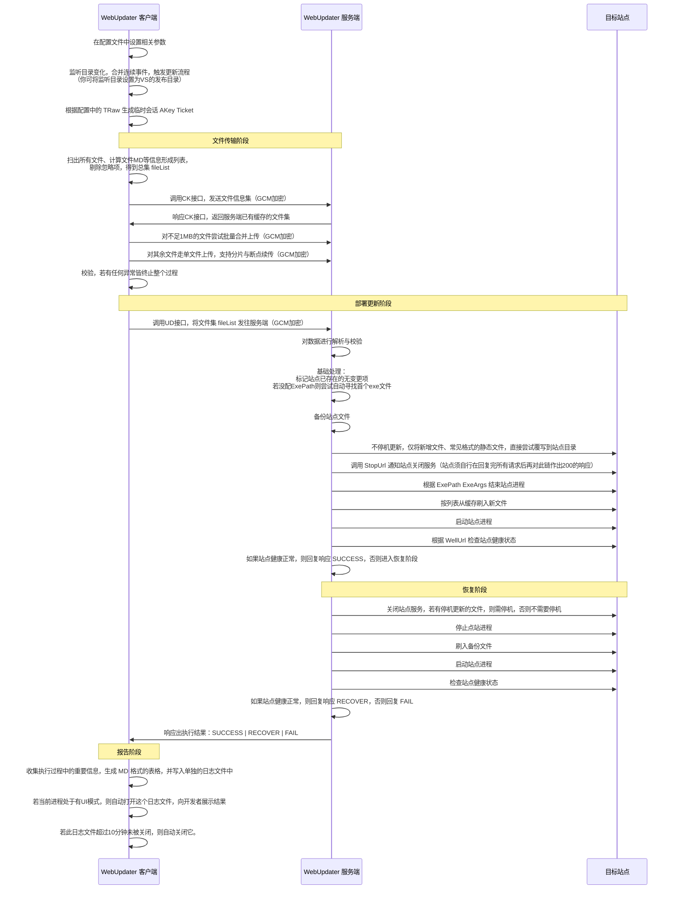


----------------------------------------

# 测试目标：抽离原生标签内容
> 实测结论：
· Chrome原生HTML标签中，属性值中不能有 `>` 符及包裹所用的引号，其他字符任意，但要注意，这里的转义要用 `&amp;` 这种。  
· Chrome原生HTML标签的内容中可以出现任意字符，会原样输出，这包括 `\\ < > " ' =` 等这类敏感符，`<>` 只要不组成合法标签就行。 
· 在style块和script块的块内容中皆不能有闭标签，即使在字串、正则、注释中也不行，也即不能嵌套。  
· 原生HTML标签区的所有东西都不被marked编译处理。


<g><h><a><b><c><n> 封闭掉这些测试过程中的残缺标签以避免对上边的内容造成影响  
//示例：一<a>二<b>三<c>四</c>五</b>六</a>七
//示例：零</n>一<a>二<b>三<c>四</c>五</b>六</a>七
//示例：零<n>一<a>二<b>三<c>四</c>五</b>六</a>七
//示例：四</c>五</b>六</a>七    //一路向左全是闭，没有对应开 
//示例：一<t>二<x>三<y>四       //一路向左全是开，没有对应闭 
//示例：一<r>二</h>三</g>四     //不对应的开闭签  
 
 
<h1>中国&lt;h1 class="cls">原生HTML测试</h1>  

<code>中国&lt;code>\<原生HTML测试</code>


桃花三两枝
<h1>测试页面</h1>
<style ks="<id>">
/* style内部不能写 </ style>，写了会提前截断 */
.test {
  color: red;
}
</style> 
<p>普通文本 <b>粗体</b></p> 
<script ks="\<<id>">
// script 引号内可以写 </ script> 不会触发闭合
const str1 = "里面可以写 </ script> 作为字符串";
const str2 = '转义引号 \' 也可以，"abc"';
const str3 = "换行\n也可以，\\反斜杠";
// 但是！引号外面不能出现 </ script>
console.log(str1);
</script> 
<div class="test" ks="<id>">内容<em>斜体</em></div>

<h1 title="ok\"a&quot;b\nc<a&gt;d" class="red">就如这\"里&quot;的**加<粗>样式**</h1>


---------------------------------------

# 测试目标：各种转义符

```
各种转义符如右：\* \+ \- \= \> \< \{ \} \` \\ \_ \| \$ \· \・
以上字符会转成 `&#92;` 或 `&lt;` 这种形式，其他字符转义后仍为原值。
```

各种转义符如右：\* \+ \- \= \> \< \{ \} \` \\ \_ \| \$ \· \・

----------------------------------------


# 测试目标：代码块

支持单个`\``开启行内代码块，这是通行标准：`这是行内代码块`

支持两个`\``开启单行代码块，这是本库扩展：``js\n多行代码块，用\\n分行``

支持三个`\``开启多行代码块：
```js
桃花三两枝
<!DOCTYPE html>{- .cc}
<html> </html>
```

支持四个空格缩进开启多行代码块：
    桃花三两枝


支持只要左侧格式整体，四个空格缩进就可以开启多行代码块：
· ·    行左的字符·和・也可以作为列表标识符，它比 -+* 这些更加形象 
  
- - 或者如下这样：
- - ```code
- - code line 2
- - ``` 

- - 也可如下这样：
- - ``cs中国人``
 
> > 也可如下这样：
> > ```code
> > code line 2
> > ``` 
 


表格中也可以插个代码块：
|写法|示例|
|-|-|
|内联写法|示例：一段`<div></div>`代码| 
|单行写法|示例：``cs\n来一段代码{--.red}``| 
|多行写法|示例：```cs
一段代码```|


 


----------------------------------------
 
# 测试目标：各种内联块

下边是各种行内表现元素标记(段尾添加两个空格可换行或与其他段内元素分离开)：  
➤ 纯CommonMark语法及GFM扩展语法：  
转义：\\  //凡在原生HTML标签区和各种代码块之外的地方，此转义符恒优先生效   
斜体：*文本斜体* |  _文本斜体_  
加粗：**文本加粗**       | __文本加粗(走MD通用标准时)__    
粗斜体：***文本粗斜体***   | ___文本粗斜体(走MD通用标准时)___    
删除线：~~GFM扩展语法~~  | --本库支持语法-- | <del>原生标签语法</del>   
下划线：__文本下划线(需显式启用开关)__ | ____文本下划线并斜体(需显式启用开关)____ | ++VS2022插件及本库支持语法++ | <u>原生标签语法</u>  //标准MD不支持下划线，扩展 `__..__` 是因为它最直观  
上角标：X^2^ | X^^^2^^^ | X<sup>2</sup> //VS2022插件及本库左一，本库还支持左二  
下角标：H~2~ | H~~~2~~~ | H<sub>2</sub> //VS2022插件及本库左一和左二  
文本高亮：==文本高亮== | <mark>文本高亮</mark> //注意4个以上的等号包裹被本库解读为居中标题  
行内代码：`行内代码`  
图片链接： |    
文本链接： [链接文本](链接地址 "可选的title属性标题") |  [链接文本](链接地址 "可选的title属性标题" .cls #ida [sex] [sex=man] [love="woman"] [cn=本库支持属性扩展]) //不支持链接祼写   
自动链接：<https://example.com> | <foo@example.com> | <mailto:foo@example.com>  
引用链接：[链接文本][foo] | [foo][] | [foo] | ![foo]  
  

[foo]: https://example.com "引用链接声明的可选的标题" 
[fon]: https://example.com "引用链接声明的可选的标题"  .cls #ida [sex] [sex=man] [love="woman"] [cn=本库支持属性扩展]
  

====居中的一级标题====
----居中的二级标题----

 


---------------------------------------  


# 测试目标：属性扩展
语法说明：`\{.cls #id [isn] [sex="man"]} | \{-- .cls #id [isn] [sex="man"]} | \{+ .cls #id [isn] [sex="man"]}`  
内置样式：.cc 文字居中 | .red 背景红色(相应的还有红黄绿...)  
 


#### 标题中的扩展样式可以在段落内的任意位置这样写{.cls #id [isn] [sex="man"]}，它可以被转义符消掉，如\{.cc}，它也可以连续写多个，比如再加一个{.iso}

- 列表的扩展样式{.cls #id [isn] [sex='man']}
 
普通段落的扩展样式：段落正{.cls #id [isn] [sex="man"]}文 | 段落正{.cls #id [isn] [sex='man']}文 | 段落正{.cls #id [isn] [sex=man]}文 | 额外格式={ }|{.cls}|{.cls#id}|{.cls #id}|{.cls #id [isn]}|{.cls #id [isn] [sex=man]}|{.cls #id [isn] [sex='man']}|{.cls #id [isn] [sex="man"]}
 
代码块中也可以插入属性扩展如{.cc}，但要注意，只能在用MD文本写的代码块才可以这样用，手写的原生HTML中的代码块不支持这个功能，这是为了保护原生HTML的兜底能力而故意设计。
 
- 属性扩展还可以沿着DOM父级节点链一路向左上去挂靠，用法如下：**这是一段加粗的文字，里边写了一个属性扩展{-- .red}，但却挂靠在ul标签身上**，这是个很有意思的扩展吧
 
- 属性扩展还可以尚着DOM开始标签一路向右去挂靠，用法如下：{+ .red}**加粗文字**，`\{...}`一路向右挂到第一个遇到的开始标签身上，这不分层级，只认开始标签。


 


--------------------------------------- 
 

# 一级标题
## 二级标题
### 三级标题
#### 四级标题
##### 五级标题
###### 六级标题 
一级标题
===============
二级标题
---------------
====居中的一级标题====
----居中的二级标题----


这是一段基本普通列表及多层级表现语法，这是 CommonMark 标准语法的列表，它需要至少2个空格缩进来表现列表的层级，在4个缩进时，优先级高于代码块被解读。
* 无序列表
+ 无序列表
- 无序列表
  - 二级无序列表
  - 二级无序列表
    - 三级无序列表
    - 三级无序列表

    
这个多层级写法不是 CommonMark 标准语法，它的本质是将下个层级嵌入一个新的li标签内，这与将ul嵌入所属li的多层级标准语法完全不是一回事，但它在直读MD时更具表现力且无歧义。  
* 无序列表
+ 无序列表
- 无序列表
- - 无序列表
- - - 无序列表

    
这是一段自定义扩展支持的无序列表，它使用 `·` 符作为列表标识符，它比 `+` `-` `*` 更具可直读表现力，除符号不同外，其用法与标准符号完全相同。  
· 扩展支持的无序列表符 
· · 扩展支持的二级无序列表
· · · 扩展支持的三级无序列表


 
预格式化文本： 

||WebAOT|Razor引擎|MVVM框架+打包工具|
|-|-|-|-|    
|前后端分离开发|✅支持|✅支持|✅支持|


| First Header  | Second Header |
| - | - |
| Content Cell  | Content Cell  |
| Content Cell  | Content Cell  |
 
 
 




 

